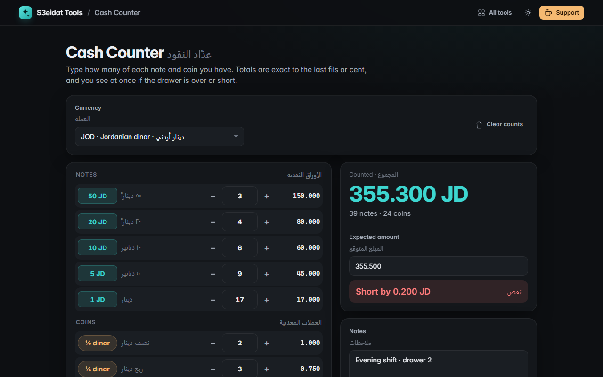

# Cash Counter · عدّاد النقود

> Count cash by notes and coins with exact totals. Free, private, and it runs entirely in your browser.

### ▶ [Open Cash Counter](https://s3eidat.github.io/cash-counter/)



## Features

- **Real denominations** for the Jordanian dinar (50, 20, 10, 5, 1 JD notes; ½ and ¼ dinar, 10, 5 and 1 piaster coins), US dollar, euro, Saudi riyal, UAE dirham, pound sterling, Kuwaiti dinar and Egyptian pound, plus your own **custom** currency
- Quantity per note and coin with + / − buttons; Enter or the arrow keys move to the next row
- **Exact totals** per row and overall with the right decimals (3 for JOD and KWD), computed in whole fils / cents so there are no rounding errors
- **Expected vs counted**: see at once whether the drawer is exact, over or short, and by how much
- Notes field, **copy summary**, **print** a clean count sheet, or download a CSV
- Arabic digits (٠١٢) and the Arabic decimal mark (٫) are accepted
- Counts are saved in this browser, separately for each currency

## Privacy

Your counts never leave your device. There is no server, no account, no analytics.
The page ships with a strict Content-Security-Policy (`connect-src 'self'`), so the browser
itself blocks any attempt to send data anywhere.

## Run it yourself

It's plain HTML, CSS and JavaScript with no build step:

```bash
git clone https://github.com/s3eidat/cash-counter
cd cash-counter
python -m http.server 8000
```

Then open http://localhost:8000.

## Support

If this saved you time, **[buy me a coffee ☕](https://s3eidat.github.io/coffee/)**. It keeps every tool free.

---

Part of **[S3eidat Tools](https://s3eidat.github.io/)**: 100+ free, private tools that run in your browser. MIT licensed.
